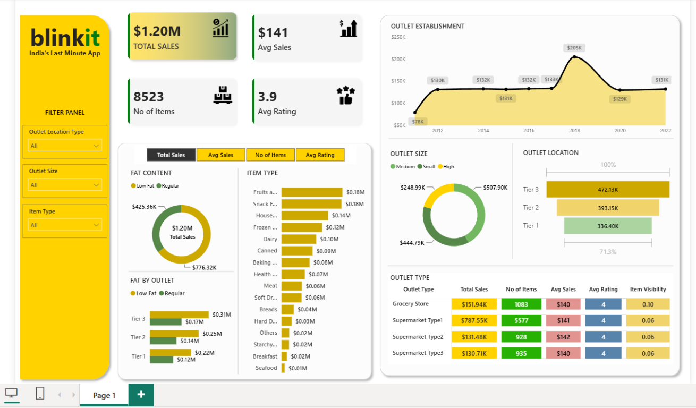

# Blinkit Grocery Sales Analysis

An interactive Power BI dashboard for analyzing Blinkit's grocery sales, customer ratings, product mix, and outlet performance.

## Dashboard preview

## Project objective

This project turns the Blinkit grocery dataset into an interactive business intelligence report. It is designed to answer questions such as:

- How much revenue is generated by fat-content category and item type?
- Which outlet locations, sizes, and establishment years perform best?
- How do average sales, item count, and customer rating vary by outlet type?
- Where are there opportunities to improve product and inventory decisions?

## Key metrics

The Power BI report tracks:

| Metric | Description |
| --- | --- |
| Total Sales | Overall revenue generated from all items sold |
| Average Sales | Average revenue per sale |
| Number of Items | Total number of items in the dataset |
| Average Rating | Average customer rating for the items sold |

## Analysis included

- Total sales by item fat content
- Total sales by item type
- Fat-content sales by outlet location
- Total sales by outlet establishment year
- Percentage of sales by outlet size
- Sales by outlet location tier
- All key metrics by outlet type

## Repository contents

| File or folder | Purpose |
| --- | --- |
| [`Blinkit.pbix`](./Blinkit.pbix) | Main Power BI report |
| [`BlinkIT Grocery Data.xlsx`](./BlinkIT%20Grocery%20Data.xlsx) | Excel source dataset |
| [`dashboard-preview.png`](./dashboard-preview.png) | Dashboard preview image |
| [`Images/`](./Images-20260126T045813Z-3-001/Images/) | KPI visual assets |
| [`BlinkIT Grocery Data.csv`](./SQL%20Data%20and%20Doc%20%28Use%20for%20SQL%20Analysis%29-20260126T045827Z-3-001/SQL%20Data%20and%20Doc%20%28Use%20for%20SQL%20Analysis%29/BlinkIT%20Grocery%20Data.csv) | CSV source used for SQL analysis |
| [`Query Doc (1).docx`](./SQL%20Data%20and%20Doc%20%28Use%20for%20SQL%20Analysis%29-20260126T045827Z-3-001/SQL%20Data%20and%20Doc%20%28Use%20for%20SQL%20Analysis%29/Query%20Doc%20%281%29.docx) | Data-cleaning and analysis queries |
| [`Blinkit Analysis.pptx`](./SQL%20Data%20and%20Doc%20%28Use%20for%20SQL%20Analysis%29-20260126T045827Z-3-001/SQL%20Data%20and%20Doc%20%28Use%20for%20SQL%20Analysis%29/Blinkit%20Analysis.pptx) | Business and visualization requirements |
| [`blinkit.json`](./SQL%20Data%20and%20Doc%20%28Use%20for%20SQL%20Analysis%29-20260126T045827Z-3-001/SQL%20Data%20and%20Doc%20%28Use%20for%20SQL%20Analysis%29/blinkit.json) | JSON data resource |

## Data preparation

The SQL analysis standardizes values in `Item_Fat_Content` so equivalent categories are grouped consistently:

- `LF` and `low fat` become `Low Fat`
- `reg` becomes `Regular`

This prevents duplicate categories from producing misleading totals and filters in the report.

## How to use

1. Install [Power BI Desktop](https://powerbi.microsoft.com/desktop/).
2. Clone or download this repository.
3. Open [`Blinkit.pbix`](./Blinkit.pbix).
4. If Power BI prompts for a data-source location, point it to [`BlinkIT Grocery Data.xlsx`](./BlinkIT%20Grocery%20Data.xlsx).
5. Use the report filters and visuals to explore sales, products, ratings, and outlet performance.

## Tools used

- Power BI Desktop
- Power Query for data preparation
- SQL for validation and analytical queries
- Excel/CSV source data

## Notes

- The `.pbix` file is a binary Power BI report and is intended to be opened in Power BI Desktop.
- Keep the source files in their current relative locations when refreshing the report.
- The dashboard is an analytical project and does not represent live Blinkit operational data.
